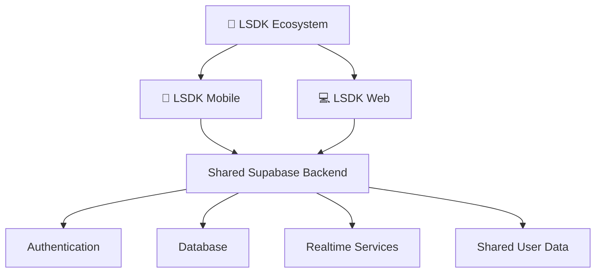
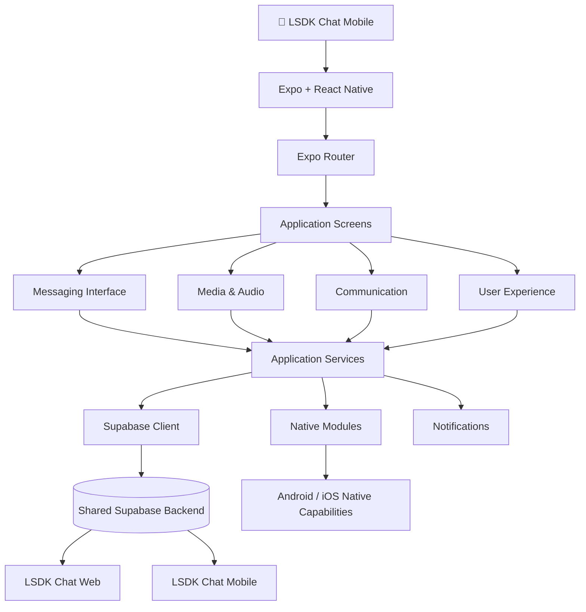

<div align="center">


<br/>

### MORE THAN MESSAGING. IT'S CONNECTION WITHOUT LIMITS.

**A modern mobile messaging experience designed around communication, creativity, community and connection.**

<br/>

[](https://expo.dev/)
[](https://reactnative.dev/)
[](https://www.typescriptlang.org/)
[](https://supabase.com/)
[](https://developer.android.com/)

<br/>

[EXPLORE](#-about-lsdk-chat) • [FEATURES](#-features) • [TECHNOLOGY](#-technology-stack) • [INSTALLATION](#-getting-started) • [ROADMAP](#-roadmap)

</div>

---

## 💜 About LSDK Chat

Communication is one of the most important parts of our everyday lives.

But messaging should be about more than sending a text and waiting for a reply.

**LSDK Chat** is a mobile messaging application developed as part of the wider LSDK ecosystem.

Built with Expo, React Native and TypeScript, it shares its Supabase backend with the LSDK Chat web application, creating a foundation for a connected messaging experience across platforms.

The vision is to bring conversations, media, voice, communities and interactive experiences together in one environment.

From everyday conversations to real-time communication, LSDK aims to make staying connected feel effortless.

> Different devices. One experience. Unlimited possibilities.

---

## 🌌 The LSDK Ecosystem

LSDK Chat Mobile is not intended to exist in isolation.

It is part of a broader ecosystem designed to bring multiple communication experiences together.



The long-term objective is to create a consistent experience across supported devices and platforms.

---

## ✨ Features & Capabilities

LSDK Mobile is being developed around a flexible messaging architecture.

### 💬 Messaging Experience

A foundation for modern digital conversations.

- Messaging-oriented application interface.
- Conversation and navigation infrastructure.
- Shared backend integration.
- Extensible communication architecture.

### 📸 Media & File Sharing

Media capabilities supported by the application's development stack.

- Image selection and processing.
- Document selection.
- File-system integration.
- Clipboard integration.
- Media-sharing infrastructure.

### 🎙️ Voice & Audio

An extensible foundation for richer communication.

- Audio functionality.
- Voice-note development infrastructure.
- Speech-recognition integration.
- Native audio capabilities.

### 📞 Real-Time Communication

LSDK's architecture includes technologies for real-time communication.

- WebRTC integration.
- Native development support for communication features.
- Foundation for audio and video calling.
- Development-build support for native functionality.

### 🔔 Notifications

Notification infrastructure designed to support communication workflows.

- Expo Notifications integration.
- Push-notification development support.
- Device integration.
- Notification-ready architecture.

### 🎮 Interactive Experiences

The project also includes dependencies supporting interactive experiences, including chess functionality.

- Chess.js integration.
- Foundation for interactive features.
- Extensible application architecture.

*Feature dependencies and development infrastructure do not necessarily mean every feature is fully implemented, enabled or production-ready.*

---

## 🛠️ Technology Stack

LSDK Mobile uses a modern React Native ecosystem.

| Technology | Purpose |
|---|---|
| Expo SDK 58 | Mobile development framework |
| React Native 0.88 | Mobile application framework |
| React 19.3 | User interface |
| TypeScript 5.9 | Type-safe development |
| Expo Router | Navigation |
| Supabase JS | Shared backend integration |
| React Native WebRTC | Real-time communication infrastructure |
| Expo Audio | Audio functionality |
| Expo Notifications | Notification infrastructure |
| React Native Reanimated | Animations |
| Jest | Automated testing |
| EAS Build | Cloud application builds |

<div align="center">


</div>

---

## 🏗️ Application Architecture

LSDK Mobile uses a modular architecture built around Expo and React Native.



### Project Structure

The repository is organised around application code, backend resources, documentation and testing.

```text
LSDK-Mobile/
│
├── __tests__/                 # Unit tests
│
├── app/                       # Expo Router application routes
│
├── assets/                    # Images, icons and other assets
│
├── backend-additions/         # Backend-related additions
│
├── backend-reference/         # Backend reference resources
│
├── docs/                      # Technical documentation
│
├── e2e/                       # End-to-end testing
│
├── scripts/                   # Development scripts
│
├── src/                       # Application source code
│
├── .env.example               # Environment variable template
├── app.json                   # Expo configuration
├── eas.json                   # EAS build profiles
├── package.json               # Dependencies and scripts
├── package-lock.json          # Dependency lockfile
├── tsconfig.json              # TypeScript configuration
└── README.md                  # Project documentation
```

---

## 💻 Getting Started

Ready to explore LSDK Mobile?

Follow these instructions to get the development environment running.

### Prerequisites

You will need:

- Node.js.
- npm.
- Git.
- An Android device or compatible emulator.
- Expo Go for supported development workflows.
- An Expo account for EAS cloud builds.
- Supabase project credentials.

### 1. Clone the repository

```bash
git clone https://github.com/LungstarDaKing/LSDK-Mobile.git
```

### 2. Navigate into the project

```bash
cd LSDK-Mobile
```

### 3. Install dependencies

```bash
npm install
```

### 4. Configure environment variables

Create your environment file:

```powershell
copy .env.example .env
```

Open `.env` and configure the required Supabase credentials using the variable names specified in `.env.example`.

Never commit your actual `.env` file.

### 5. Run TypeScript validation

```bash
npm run typecheck
```

### 6. Run automated tests

```bash
npm test
```

### 7. Start the application

```bash
npx expo start
```

Scan the QR code using a compatible Expo Go installation.

**Important:** Phase 1 supports Expo Go. Native functionality such as calling, voice notes and phone push notifications requires an appropriate development build.

---

## 📦 Building for Android

LSDK Mobile uses Expo Application Services for cloud builds.

### Install EAS CLI

```bash
npm install -g eas-cli
```

### Authenticate

```bash
eas login
```

### Initialise EAS

```bash
eas init
```

### Generate a preview APK

```bash
eas build --profile preview --platform android
```

### Generate a development build

```bash
eas build --profile development --platform android
```

### Generate a production Android build

```bash
eas build --profile production --platform android
```

### iOS builds

iOS production builds require an Apple Developer account.

```bash
eas build --profile production --platform ios
```

Build configuration is maintained in `eas.json`.

---

## 🧪 Testing & Code Quality

A messaging application requires consistent testing and reliable application behaviour.

LSDK Mobile includes Jest and Jest Expo for automated testing.

Available commands:

```bash
# Run TypeScript validation
npm run typecheck

# Run automated tests
npm test

# Run the Expo development server
npm start

# Start the web version
npm run web

# Run Expo dependency diagnostics
npm run doctor

# Export the web application
npm run export:web
```

Testing is an ongoing part of development. Successful automated checks do not replace real-device testing, backend security reviews or production readiness checks.

---

## 🔐 Security & Privacy

Communication platforms handle sensitive information.

LSDK Chat is being developed with security and privacy as important architectural considerations.

Development principles include:

- Secure handling of authentication credentials.
- Protected backend access.
- Appropriate database access policies.
- Secure storage of sensitive local information.
- Responsible handling of user-generated media.
- Appropriate notification permissions.
- Careful management of audio and communication permissions.
- Protection of private application configuration.

**Important:** Never expose Supabase service-role keys, private API keys, authentication secrets or passwords in a public repository.

Use the Supabase publishable key where appropriate and enforce database access through correctly configured Row Level Security policies.

---

## 🗺️ Development Roadmap

LSDK Chat is an evolving project.

The following roadmap describes the broader development direction, not a guarantee that every feature is already available.

### Foundation

- [x] Expo and React Native application foundation.
- [x] TypeScript integration.
- [x] Expo Router integration.
- [x] Supabase backend connectivity foundation.
- [x] Environment configuration template.
- [x] Unit-testing infrastructure.
- [x] End-to-end testing directory.
- [x] EAS cloud-build configuration.

### Communication

- [ ] Expand and validate messaging workflows.
- [ ] Improve real-time communication.
- [ ] Complete voice-note workflows.
- [ ] Expand audio and video calling.
- [ ] Improve push-notification reliability.

### Media & Experiences

- [ ] Expand media-sharing functionality.
- [ ] Improve document and attachment handling.
- [ ] Develop interactive communication experiences.
- [ ] Expand chess and other interactive features.

### Ecosystem

- [ ] Strengthen mobile and web parity.
- [ ] Improve shared backend architecture.
- [ ] Expand account and session management.
- [ ] Improve cross-platform consistency.
- [ ] Prepare for wider public testing.

**The destination: One connected LSDK experience across devices.**

---

## 🤝 Contributing

LSDK Mobile is an evolving project.

Constructive contributions, technical feedback and ideas are welcome.

To contribute:

1. Fork the repository.
2. Create a feature branch.
3. Implement your changes.
4. Run the available tests.
5. Submit a pull request describing your contribution.

```bash
git checkout -b feature/your-feature

git add .

git commit -m "feat: describe your contribution"

git push origin feature/your-feature
```

Contributions should prioritise:

- Code quality.
- Application performance.
- Accessibility.
- Security.
- Maintainability.
- Consistent user experience.

---

## 👨‍💻 The Creator

<div align="center">


### Lungelo "LungstarDaKing" Mtetwa

**Founder & Developer | LSDK Ecosystem**

An aspiring technology entrepreneur and software developer passionate about artificial intelligence, mobile applications, software engineering and innovation.

LSDK is part of a broader vision to create technology that connects people and makes everyday digital experiences better.

The philosophy is simple:

**Don't just use technology. Build something that moves it forward.**

<br/>

[](https://github.com/LungstarDaKing)

[](https://github.com/LungstarDaKing/LSDK-Mobile)

[](https://github.com/LungstarDaKing/LSDK-Chat)

</div>

---

## 📜 License

No open-source licence is currently specified in this repository.

Until a licence is added, all rights are reserved by the copyright holder. Do not assume the source code is available for unrestricted reuse or redistribution.

---

<div align="center">


# LSDK CHAT

### More Than Messaging. It's Connection Without Limits.

**One ecosystem. One vision. Endless possibilities.**

<br/>


<br/><br/>

**© Lungelo Mtetwa · LSDK Ecosystem**

</div>
